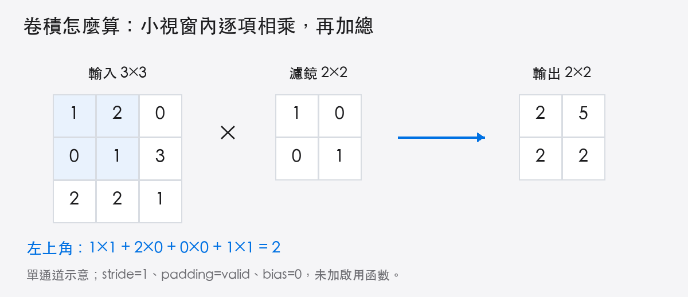
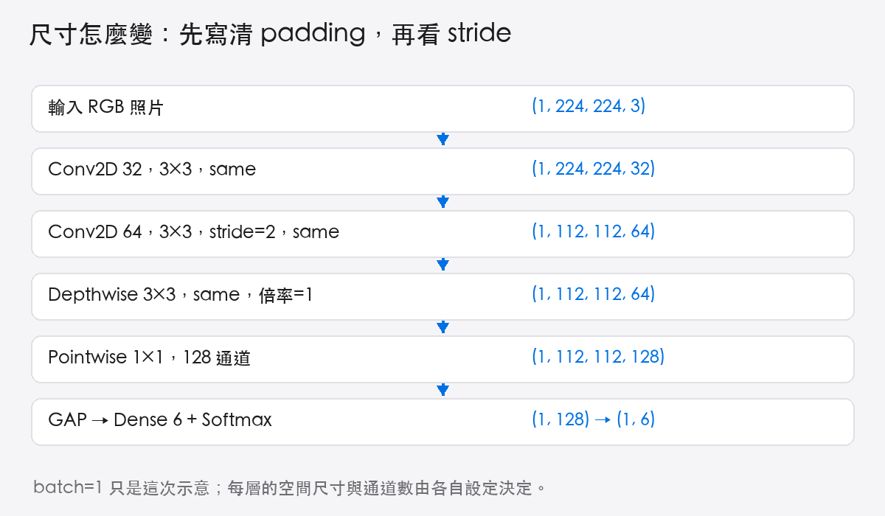
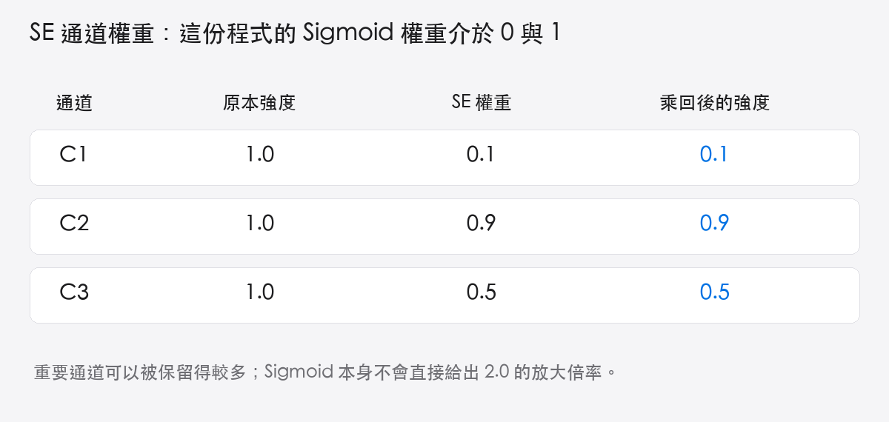
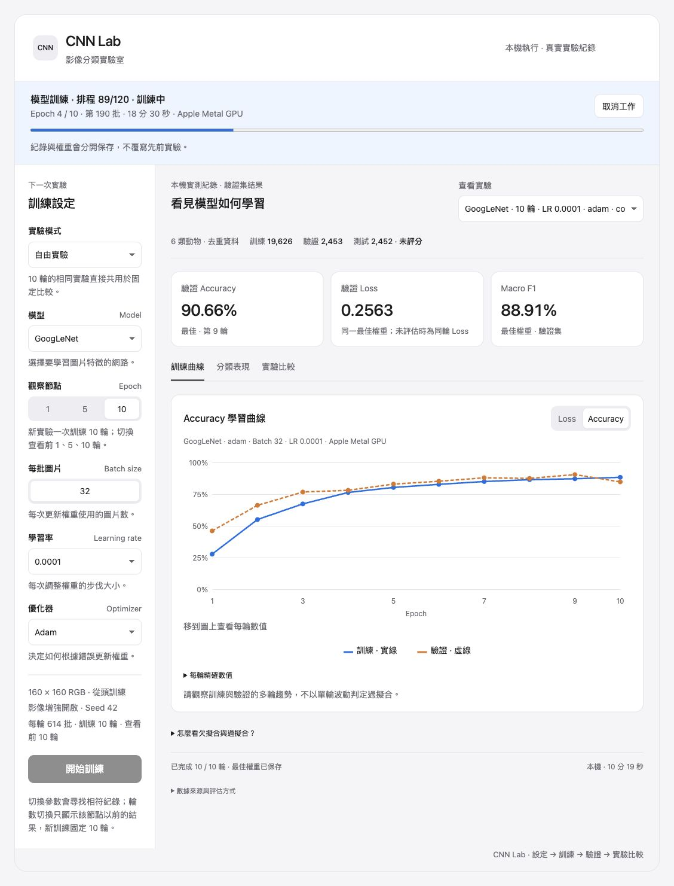
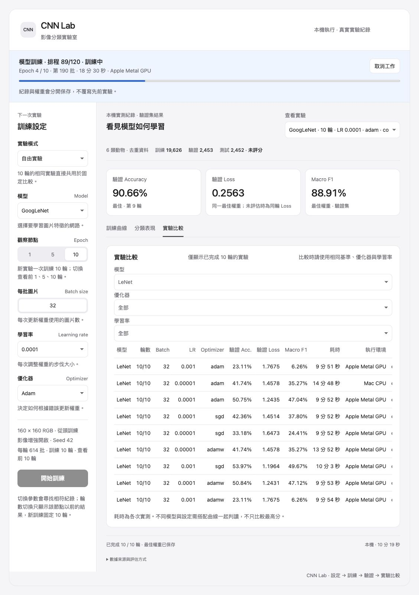
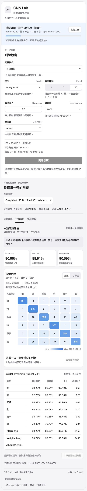

# CNN 模型學習實驗室

## 一、專案核心目標

用六類動物影像實作經典 CNN，透過互動介面比較模型、學習率與優化器，練習解讀曲線和分類指標。模型保留各自核心特色，部分結構依學習任務簡化。

目前為分階段整理版本：環境依賴與介面設定檔仍待補齊，Docker 尚待實測；以下是環境備妥後的訓練流程。專案不提供訓練照片與權重，請使用自己有權使用的圖片；展示數值可另外瀏覽。

## 二、CNN 基礎名詞介紹

| 名詞 | 簡單理解 |
|---|---|
| 卷積／Kernel | 用一組可學習的權重掃過局部區域，提取特徵。 |
| 特徵圖／Channel | 卷積產生的特徵表示；不同通道可學到不同模式。 |
| Stride／Padding | 控制移動步幅與邊界補值，影響輸出尺寸。 |
| Pooling／GAP | 彙整空間資訊；GAP 將每個通道取全域平均。 |
| ReLU／Swish | 加入非線性，讓模型能表達複雜關係。 |
| BN | 用訓練批次的統計量調整特徵；推論通常使用移動統計量。 |
| 殘差連接 | 將捷徑輸入與支路輸出相加，幫助深層網路學習。 |
| Depthwise／Pointwise | 分別處理各通道的空間特徵，再用 1×1 卷積混合通道。 |
| SE | 學習各通道的權重，調整特徵的重要程度。 |
| Epoch／Batch／學習率 | 看完一次訓練集／每次更新使用的圖片數／權重更新的步伐。 |

### CNN卷積從頭看

#### 一張圖片在程式裡是什麼

圖片可以視為數字陣列。這份程式通常使用 `(batch, height, width, channels)` 的排列方式：

```text
(32, 224, 224, 3)
 │    │    │   └─ RGB 三個通道
 │    └────┴───── 每張圖片高 224、寬 224
 └─────────────── 一批 32 張圖片
```

`batch` 不是通道數。照片經過卷積後，通道通常代表不同的特徵反應，不再只是 RGB，也不代表固定的動物種類。

#### 卷積就是滑動視窗內的乘加

小濾鏡在圖片上移動，每個位置做對應數字相乘，再加總。下面用單通道、2×2 濾鏡示範，忽略 bias 與啟用函數：



左上角的計算是 `1×1 + 2×0 + 0×0 + 1×1 = 2`。視窗往右、往下移動後，得到整張輸出。實際 RGB 標準卷積還會一起加總輸入通道的資訊；訓練時會學習濾鏡數值，並非都由人手設定。

#### Kernel、Filters、Stride、Padding

| 設定 | 白話意思 | 主要影響 |
| --- | --- | --- |
| `kernel_size=3` | 用 3×3 的空間視窗。 | 每次看多大的局部範圍。 |
| `filters=32` | 學習 32 個輸出濾鏡。 | 標準 Conv2D 的輸出有 32 個通道。 |
| `strides=2` | 視窗一次移動兩格。 | 通常讓空間尺寸變小。 |
| `padding="valid"` | 不在邊界補值。 | 視窗放不下的邊界不會產生輸出。 |
| `padding="same"` | 依需求在邊界補值。 | stride=1 時空間尺寸相同；stride>1 仍會縮小。 |

`Conv2D` 沒寫 padding 時，預設是 `valid`。所以「3×3 卷積一定保持原大小」是不正確的。以高寬都是 224 為例：

| 卷積設定 | 輸出高寬 |
| --- | --- |
| 3×3、stride=1、valid | 222×222 |
| 3×3、stride=1、same | 224×224 |
| 3×3、stride=2、valid | 111×111 |
| 3×3、stride=2、same | 112×112 |

不考慮 dilation 時，一個方向的輸出尺寸是 `floor((輸入尺寸 + 前後補值總量 - kernel_size) / stride) + 1`；有 dilation 時，先把 kernel 的有效大小改成 `dilation × (kernel_size - 1) + 1`。same 模式會依 stride 決定補值，輸出尺寸是 `ceil(輸入尺寸 / stride)`。[Conv2D 官方定義](https://keras.io/api/layers/convolution_layers/convolution2d/)

#### 一條完整的尺寸變化



這是教學用的小流程，不代表十種模型都走相同結構。每層的 padding、stride、通道數都要分開看。

#### 為什麼 1×1 卷積有用

1×1 卷積雖然空間視窗很小，仍能在同一位置混合輸入通道資訊，並調整輸出通道數。例如 `Conv2D(128, 1)` 可將 64 個輸入通道組合成 128 個輸出通道。

它常用於降通道、擴張或投影。單獨一層線性 1×1 卷積不會自動產生非線性；模型會另外搭配 ReLU、Swish 等啟用函數。

#### Depthwise 與 Pointwise 分別做什麼

- **Depthwise 3×3**：各輸入通道使用各自可學習的濾鏡，處理空間特徵；這一步不混合不同輸入通道。
- **Pointwise 1×1**：混合通道，並設定輸出通道數。
- Depthwise 的輸出通道數是 `輸入通道數 × depth_multiplier`，只有 multiplier=1 才維持通道數。

Depthwise 是可學習的卷積，不是「沒有學習能力的運算」。把 DW 與 PW 拆開，可以減少特定設定下的計算量與參數，但實際速度仍要測量。[DepthwiseConv2D 官方定義](https://keras.io/api/layers/convolution_layers/depthwise_convolution2d/)

以輸入 64 通道、輸出 128 通道、depth_multiplier=1 為例，不計 bias、BN：

```text
標準 3×3 卷積：3×3×64×128 = 73,728 個權重
DW 3×3 + PW 1×1：3×3×64 + 1×1×64×128 = 8,768 個權重
```

#### Pooling、Flatten 與 GAP

- **Max Pooling**：保留局部區域的最大值。
- **Average Pooling**：取局部區域的平均值。
- **Flatten**：把高度、寬度、通道一起攤平成一列，後續 Dense 的參數量會受輸入尺寸影響。
- **GAP**：對每個通道取空間平均，將 `(batch, H, W, C)` 變成 `(batch, C)`。

GAP 能減少分類頭對空間大小的直接依賴，但不能因此忽略舊權重使用的縮圖與正規化設定。

#### SE 是替通道調整權重

這份 EfficientNet 的 SE 流程是 `GAP → 降通道 → 恢復通道 → Sigmoid → 乘回特徵`。乘回後，特徵圖的形狀不變。



Sigmoid 的輸出介於 0 與 1，不能用 SE 權重 2.0 來說明這份程式。重要通道可以被保留得較多，其他通道被抑制得較多。這份 MBConv 的 SE 放在 Depthwise 之後、Pointwise 投影之前。[SE 原始論文](https://arxiv.org/abs/1709.01507)、[本專案實作](models/efficientnet.py)

#### BN、Dropout 與殘差連接

- **BN**：訓練時使用批次統計並更新移動統計；推論時使用保存的統計量。
- **Dropout**：訓練時隨機關閉部分訊號，推論時關閉此隨機處理。
- **殘差連接**：將主路徑結果與捷徑相加；兩路形狀必須一致，必要時用投影調整。

EfficientNet 的殘差支路使用逐樣本遮罩：每張圖片只有一個保留或丟棄的值，廣播到整個 H×W×C 特徵圖，保留時依存活率縮放，推論時關閉隨機丟棄。它只把已算出的支路輸出設為零，不會跳過前面的卷積計算。

## 三、本次模型

LeNet、AlexNet、AlexNet＋LRN、VGG16、VGG16＋BN、GoogLeNet、Inception v2、ResNet50、MobileNet v1、EfficientNet-B0。

- CNN Lab 的「模型介紹」頁籤整合架構圖與論文差異，沿用相同介面風格；啟動方式見 [網站說明](webs/README.md)。
- [模型介紹離線 HTML](docs/models.html)：下載專案後可直接用瀏覽器閱讀；GitHub 檔案頁會顯示原始碼。
- [模型特色與論文架構差異](docs/model-differences.md)：各實作保留與調整的部分。

## 四、實驗方法

固定資料切分、160×160 RGB、Batch 32 與 Seed 42；每模型比較三種學習率與四種優化器，每組訓練 10 輪。使用最佳驗證權重觀察 Loss、Accuracy、F1、Recall 與混淆矩陣，測試集留到最後。

實驗結果展示網站整理中，預計提供不含權重的互動數值；本機模式另提供從零訓練。

詳見 [實驗方法與目前限制](docs/experiment-method.md) · [本機網站說明](webs/README.md)。介面提供訓練設定、曲線、分類表現與實驗比較；目前沒有公開部署網站。

**訓練曲線**：觀察訓練與驗證 Accuracy 隨輪次的變化。



**實驗比較**：依模型、優化器與學習率篩選已完成的結果；圖中為 LeNet 篩選示例。



**分類表現**：混淆矩陣與六類 Precision、Recall、F1。



*實際介面截圖，呈現個別驗證結果，並非最終測試成績或模型排名。*

### 訓練與評估如何讀

`main_train.py` 依七段讀取設定、建立模型、準備照片、compile、準備 callbacks、fit、載回最佳權重。只有真正執行到 fit 才開始訓練。

第五節的 `config_user.yaml` 範例使用六類、160×160、batch 32、10 epochs、Adam、學習率 0.0001；其他實驗設定檔可以使用不同數值。範例值不代表已經適合資料，應以各次實驗保存的設定為準。未指定 `--config` 時，程式會讀取根目錄的 `config.yaml`；目前發布版本尚未附上此檔案。訓練增強包含旋轉、平移、縮放、形變與設定中的翻轉，未加入亮度增強或重新抽樣。

`main_test.py` 不訓練，使用相同批次的圖片與答案計算 Accuracy、Top3、Precision、Recall、F1 與混淆矩陣。驗證集和測試集是不同資料，不能把 validation accuracy 直接當 test accuracy。

- Accuracy：全部照片答對多少。
- Precision：被判成某一類的照片，有多少真的屬於該類。
- Recall：某一類的照片，有多少被找回。
- F1：平衡 Precision 與 Recall，仍需逐類一起看。
- GoogLeNet 啟用輔助輸出時，訓練的 loss 包含輔助輸出的加權損失；測試顯示的 loss 僅計主要分類輸出，兩者不能直接當成相同數字比較。

新實驗會保存權重、設定 JSON 與逐輪 CSV。這些紀錄有助追查，但目前不包含所有圖片的內容雜湊，也不保證跨版本、平台能完全重現。

## 五、資料夾內容

| 檔案／資料夾 | 分工 |
|---|---|
| [main_train.py](main_train.py) | 訓練入口，讀設定、建立模型、保存最佳權重與紀錄。 |
| [main_test.py](main_test.py) | 評估入口，載入權重並計算分類指標。 |
| [models/](models/) | 十種 CNN 實作與統一模型入口。 |
| [tools/](tools/) | 資料、標記、設定與網站後端工具。 |
| [tests/](tests/) | 資料安全、架構及介面流程檢查；完整執行仍需補齊環境與設定。 |
| [webs/](webs/) | CNN Lab 前端與操作說明。 |
| [docs/](docs/) | 模型圖解、架構差異、實驗方法與截圖。 |
| [data_animal_pictures/](data_animal_pictures/) | 目前只有匿名資料統計，沒有照片。 |

| 工具 | 用途 |
|---|---|
| [data_safety.py](tools/data_safety.py) | 檢查分類資料操作，預覽並避免覆寫。 |
| [dataloader.py](tools/dataloader.py) | 讀取圖片、檢查類別、套用訓練增強。 |
| [labeling.py](tools/labeling.py)、[labeling_fast.py](tools/labeling_fast.py) | 使用現成模型輔助標記；結果仍需人工抽查。 |
| [main_fix_filenames.py](tools/main_fix_filenames.py) | 預覽與安全重新命名圖片。 |
| [utils.py](tools/utils.py) | 讀取設定、建立優化器、保存實驗資訊。 |
| [web_app.py](tools/web_app.py)、[web_worker.py](tools/web_worker.py) | 提供本機介面、派工、進度與驗證報告。 |
| [cuda_check.py](tools/cuda_check.py)、[run_model_checks.py](tools/run_model_checks.py) | 檢查裝置或模型執行狀況。 |

### 用自己的照片訓練

**流程：照片依類別分好 → 填寫設定 → 執行訓練 → 保存權重與紀錄。** 不需要先有權重，也不必逐支執行 `tools/` 裡的工具。

**1. 放入照片。** 本專案的資料夾名稱是 `data_animal_pictures/`（相當於一般專案的 `data/`）。先自行分成訓練、驗證、測試三組，每組都建立相同的六個類別資料夾：

```text
data_animal_pictures/
├── train/                 # 用來學習
│   ├── cat/               # 放貓的圖片
│   ├── dog/
│   ├── fox/
│   ├── leopard/
│   ├── lion/
│   └── wolf/
├── val/                   # 同樣六個子資料夾，用來選最佳權重
└── test/                  # 同樣六個子資料夾，保留到最後評估
```

每個類別都要有圖片；不要把同一張照片、其複本或同來源的近似圖片分到不同組。`main_train.py` **不會自動切分或去重**。資料夾名稱就是標籤；輔助標記工具是選用功能，已分好類別便不需要再跑。

**2. 填寫設定。** 在專案根目錄建立 `config_user.yaml`，指定模型、參數與照片位置。相對路徑一律以專案根目錄為準。

<details>
<summary>展開可複製的設定範例（LeNet、六類動物）</summary>

```yaml
model:
  name: lenet
  num_classes: 6
  input_size: [160, 160]
  aux_logits: false
training:
  batch_size: 32
  epochs: 10
  learning_rate: 0.0001
  optimizer: adam
  seed: 42
  early_stopping: false
augmentation:
  use_aug: true
  rotate: 10
  flip: true
  color_jitter: false
dataset:
  train_dir: data_animal_pictures/train
  val_dir: data_animal_pictures/val
  test_dir: data_animal_pictures/test
save:
  checkpoint_dir: weights/my_experiment
  log_dir: logs/my_experiment
```

`model.name` 可填 `lenet`、`alexnet`、`alexnet_lrn`、`vgg16`、`vgg16_bn`、`googlenet`、`inception`、`resnet50`、`mobilenet_v1`、`efficientnet_b0`；`optimizer` 可填 `adam`、`sgd`、`adamw`、`rmsprop`。使用 GoogLeNet 輔助輸出時才將 `aux_logits` 改為 `true`。上述參數只是起點，不保證適合所有模型。

</details>

**3. 開始訓練。** 在專案根目錄、已安裝相容依賴的 Python 環境執行：

```sh
python main_train.py --config config_user.yaml
```

程式會自動呼叫 `tools/dataloader.py` 讀圖、調整尺寸與套用訓練增強，再建立模型並訓練。權重與 CSV 紀錄分別寫入設定中的 `weights/`、`logs/`，終端機會印出實際檔案位置。最佳權重依**驗證 Accuracy**選出，不一定是第 10 輪；請一併保留權重旁的設定與類別 JSON。

**4. 最後才評估測試集。** 完成參數選擇後，使用同一份設定，把下面的路徑換成訓練印出的權重位置：

```sh
python main_test.py --config config_user.yaml --weights "weights/my_experiment/實際權重檔名.h5"
```

若希望用網頁選參數、看進度與分類指標，請使用 [CNN Lab 本機模式](webs/README.md)。介面另需 `config_lab.yaml` 與完整環境；上述命令列設定不會自動變成介面設定，命令列訓練也不會自動產生 Lab 工作紀錄。**目前網頁訓練流程以六類動物為範圍**；若改成其他分類任務，需另外調整類別數與介面。
