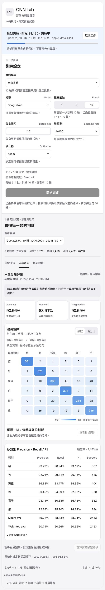

# 實驗方法

> [!IMPORTANT]
> 最新快照保留108組非Inception比較，Inception因數值異常全部暫停採信。先閱讀 [實驗結果與可信度報告](experiment-results.md)。

## 固定條件

- 六類：cat、dog、fox、leopard、lion、wolf；訓練 19,626、驗證 2,453、測試 2,452 張。
- 依檔案雜湊、解碼像素與已知同源群組去重再分組；不保證排除所有視覺近似圖。統計見 [summary.json](../data_animal_pictures/summary.json)。照片未隨 repo 提供，來源與再散布授權仍待確認。
- RGB 160×160、Batch 32、Seed 42、相同影像增強，從零訓練。
- 每組一次訓練 10 輪；保存 1／5／10 輪節點當下的最佳權重。觀察第 5 輪是看這次十輪訓練的前五輪，不是重新訓練五輪。

## 改變的選項

| 項目 | 選項 |
|---|---|
| 模型 | 十種學習實作 |
| 學習率 | 0.00001、0.0001、0.001 |
| 優化器 | Adam、SGD、AdamW、RMSprop |

每模型 12 組，共 120 組。比較學習率時固定模型與優化器；比較模型時固定優化器與學習率。各模型自行選最佳設定是另一種比較，須另外標示。

## 權重與評估

以每組十輪內驗證 Accuracy 最高的權重為候選，完成後載入同一權重計算驗證 Loss、Accuracy、Precision、Recall、F1 與混淆矩陣。低分結果保留；執行失敗不得算完成。

發布副本的展示比較表與10輪摘要，Accuracy／Loss／F1 統一取載回最佳權重後的同一次評估；逐輪曲線及1／5輪節點仍取歷史紀錄。全部設定與多seed實驗尚未收尾，因此展示不是最終排名。

CPU 與 Metal 結果分開標註，正式 GPU 比較仍需補齊 CPU 設定。部分耗時包含休眠與人工暫停，只供紀錄，不能直接作為速度排名。最佳候選多 seed 驗證與最終測試集評分尚未完成。

## 呈現介面

[介面程式與說明](../webs/README.md) 提供參數選擇、學習曲線、混淆矩陣、各類別指標與實驗篩選。

截圖為 GoogLeNet／Adam／學習率 0.0001 的個別驗證結果；不代表全部實驗已完成。GitHub 不會直接執行 Python 網站；環境清單與設定範例已提供；本機訓練仍需自行準備合法的分類照片，安裝方式見 [環境安裝與驗證](setup.md)。
